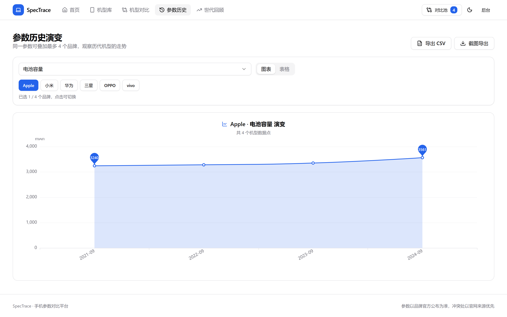
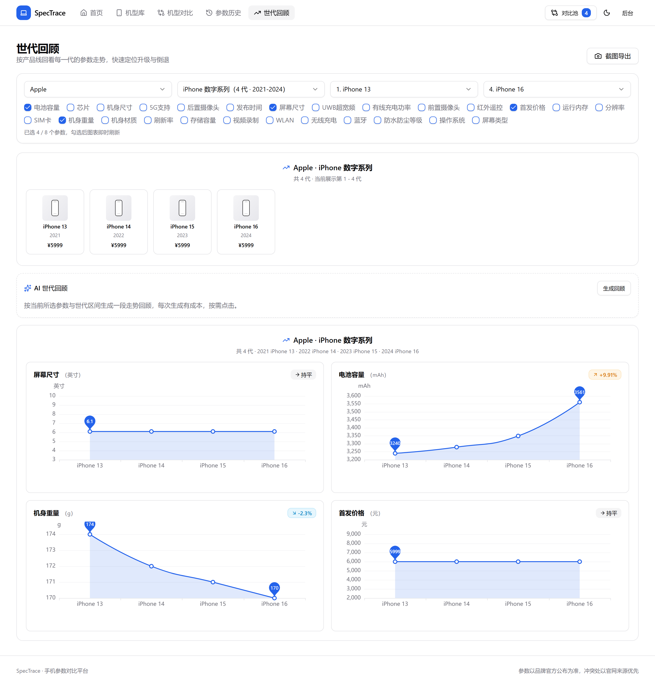

# SpecTrace · 手机参数对比平台

[](https://github.com/jingyuan9527/SpecTrace/actions/workflows/ci.yml)
[](https://github.com/jingyuan9527/SpecTrace/actions/workflows/docker-publish.yml)

面向数码爱好者的手机参数数据库：收录多品牌机型参数，支持**多机型横向对比**、**单参数跨代历史演变**、**按产品线回看世代（多参数趋势）**、**对比结果一键截图分享**；数据来源为管理员手动录入 + 内嵌 AgentScope AI Agent 自动抓取（抓取结果必须人工审核后入库）。

> 仓库地址：<https://github.com/jingyuan9527/SpecTrace>
> 容器镜像：`ghcr.io/jingyuan9527/spectrace-{backend,frontend}`，以及前后端一体化镜像 `ghcr.io/jingyuan9527/spectrace-app`

## 界面预览

> 截图取自内置演示数据（6 台机型 + 1 条待审核记录）。机型缩略图为按品牌主色生成的占位图，不是真实产品照片；演示机型的参数为节选，未录入的参数在页面上不显示。

| 首页：搜索、品牌导航与热门机型 | 机型库：品牌 / 年份筛选，勾选进对比 |
| :---: | :---: |
|  |  |

| 机型对比：差异高亮、水印、分享链接与复制图片 | 机型详情：存储版本发布价、参数来源与更新时间 |
| :---: | :---: |
|  |  |

| 参数历史：单参数跨代演变，多品牌叠加 | 世代回顾：多参数趋势 + AI 走势回顾 |
| :---: | :---: |
|  |  |

| 后台机型管理：录入、批量导入与复制 | 后台待审核：AI 抓取结果人工审核后入库 |
| :---: | :---: |
|  |  |

## 架构

```
┌──────────────────────────┐   HTTP    ┌────────────────────────────────────────┐
│  Vue3 前端（访客端/后台）│ ────────► │  SpringBoot 3.x 后端（单体应用）        │
│                          │ ◄──────── │   业务：MyBatis-Plus / JWT / RBAC       │ ──► SQLite（单文件主业务库）
└──────────────────────────┘           │   采集：内嵌 AgentScope Java 2 Agent    │ ──► 内存任务队列（可选 Redis）
                                       └────────────────────────────────────────┘
```

采集 Agent 与业务后端**同一进程、同一份镜像**：任务经队列（默认内存，可选 Redis）投递，Agent 直接调用后端 Service 完成「搜索 → 抓取 → LLM 结构化抽取 → 写待审核库」，无 HTTP 往返，也无需单独部署 Agent 服务。

**职责精简**：Agent 不直接访问数据库，只负责采集与结构化；入库、审核状态流转仍全部由 SpringBoot 掌管。
**零外部服务**：业务数据保存在 SQLite 单文件，任务队列默认使用进程内内存；只有多实例部署时才需要可选启用 Redis。

## 目录结构

```
SpecTrace/
├── backend/         SpringBoot 3.3 + MyBatis-Plus + 内嵌采集 Agent（SQLite 单文件库，src/test 为单测）
├── frontend/        Vue3 + TypeScript + TailwindCSS + shadcn-vue + ECharts + html2canvas
├── docs/screenshots/        README 界面截图（演示数据）
├── sql/             旧版 MySQL 建表脚本（仅迁移参考，当前应用不再使用）
├── .github/workflows/ci.yml               PR 校验：类型检查、构建、单测与 e2e
├── .github/workflows/docker-publish.yml   构建并推送单镜像到 GHCR
├── Dockerfile       前后端一体单镜像（构建上下文 = 仓库根目录）
├── docker-compose.yml       应用编排（默认拉取 GHCR 单镜像，SQLite 数据落宿主机挂载目录）
├── docker-compose.build.yml 源码构建覆盖文件
└── .env.example             部署环境变量样例
```

## 快速启动（本地开发）

### 1. 后端（内含采集 Agent，无需安装 MySQL / Redis）

```bash
cd backend
mvn spring-boot:run
```

- 默认使用 SQLite 文件库 `backend/data/spectrace.db`，启动时自动建表、幂等写入种子数据
- 端口 `8080`，接口文档：http://localhost:8080/swagger-ui.html
- 数据文件路径可用 `SPECTRACE_DB_PATH` 覆盖（例如 `SPECTRACE_DB_PATH=D:/data/spectrace.db`）
- 初始超级管理员：`admin / admin123`（启动时以 BCrypt 写入）
- **采集 Agent 随应用启动常驻消费任务**：先在后台「AI 配置」保存连接与模型（填好 API Key），再到「抓取任务」提交任务即可自动采集
- 关闭内嵌 Agent：启动加 `--spectrace.agent.enabled=false`（或环境变量 `SPECTRACE_AGENT_ENABLED=false`）
- 只处理一个任务（联调）：`mvn spring-boot:run -Dspring-boot.run.arguments=--once`

### 2. 前端

```bash
cd frontend
npm install
npm run dev
```

- 访问 http://localhost:5173 ，已配置 `/api`、`/uploads`、`/brands`、`/device-images` 代理到后端 8080（机型图必须走独立前缀，与 SPA 的 `/devices` 路由同名会被代理吞掉）
- 前端使用 history 路由（无 `#`）：`/` 首页、`/devices` 机型库、`/compare` 对比、`/history` 参数历史、`/evolution` 世代回顾
- 管理后台：`/admin/login`
- E2E（无需后端与数据库，接口由 `e2e/mock-api.ts` 拦截）：`npx playwright install chromium` 后执行 `npm run test:e2e`；失败会保留截图、trace 与视频到 `test-results/`

## 采集 Agent（内嵌）

基于 **AgentScope Java 2.0 Harness 模式**（`HarnessAgent` + `Toolkit`）：persona / 输出规约写在**工作区 `AGENTS.md`**（Harness 的「智能体定义事实来源」，运行期可直接编辑、无需改码），自定义工具 `web_search` / `fetch_page`（Jsoup 抽取正文）。

- 工作区目录由 `AGENTSCOPE_WORKSPACE` 控制（默认 `.agentscope/workspace`），首次启动把内置 persona 写入其下 `AGENTS.md`
- **persona 版本同步**：内置 `backend/src/main/resources/AGENTS.md` 升级后，启动时按内容 SHA-256 与工作区 `AGENTS.md.sha256` 比对；版本变化会把旧文件备份为 `AGENTS.md.bak-<时间戳>` 再覆盖，版本未变则保留工作区里的手工修改
- 任务获取实现由 `spectrace.agent.queue` 决定：`memory`（默认，进程内队列，无外部服务）/ `redis`（可选，`BLPOP spectrace:agent:task`，多实例部署）；后端投递与 Agent 消费共用同一实现
- 每个任务执行前解析一次 AI 模型参数，后台「AI 配置」改完**下个任务即生效**，无需重启
- AI 连接（服务商 / 接口地址 / API Key）与模型在后台「AI 配置」页面维护：保存连接后可**拉取远端模型**、一次导入多个模型并设默认；创建抓取任务时可指定模型，缺省用默认模型

可调环境变量（`application.yml` 中均有同名默认值）：

| 变量 | 默认 | 说明 |
| --- | --- | --- |
| `SPECTRACE_DB_PATH` | `./data/spectrace.db` | SQLite 数据文件路径 |
| `SPECTRACE_AGENT_ENABLED` | `true` | 是否启用内嵌采集 Agent |
| `SPECTRACE_AGENT_QUEUE` | `memory` | 任务队列：`memory` / `redis` |
| `AGENTSCOPE_WORKSPACE` | `.agentscope/workspace` | Harness 工作区目录 |
| `POLL_INTERVAL_SECONDS` | `5` | 阻塞等待任务的超时（秒） |
| `TASK_TIMEOUT_SECONDS` | `180` | 单任务最长耗时（秒） |
| `CRAWL_INTERVAL_SECONDS` | `2` | 每次外网请求间隔（秒），抓取风控 |
| `SEARCH_RESULT_LIMIT` | `5` | 搜索结果条数上限 |
| `SERPER_API_KEY` | 空 | 留空用 DuckDuckGo 免 key 抓取，填入则用 Serper |
| `DASHSCOPE_API_KEY` / `DASHSCOPE_MODEL` | 空 / `qwen-max` | 后台未配置 AI 连接时的兜底 |
| `AGENT_ALERT_THRESHOLD` | `3` | 采集任务连续失败达到该次数写 `AGENT_CONSECUTIVE_FAILURE` ERROR 日志，0 关闭 |
| `AGENT_ALERT_WEBHOOK` | 空 | 告警 webhook（钉钉机器人文本消息格式），留空只写日志 |
| `SPECTRACE_PUBLIC_BASE_URL` | 空 | 站点对外域名（含协议），用于 sitemap / robots；反向代理部署必须配置，否则回退请求域名 |
| `SPECTRACE_UPLOAD_MAX_BYTES` | `8388608` | 单张图片硬上限（字节）；前端会先压到 500KB，超限提示裁剪 |
| `SPECTRACE_AI_INSIGHT_ENABLED` | `true` | 是否开放 AI 摘要类能力（对比差异摘要、世代回顾文案），未配置模型时前端自动隐藏入口 |
| `SPECTRACE_AI_INSIGHT_CACHE_HOURS` | `24` | 摘要缓存时长（小时），同一组机型与参数值在窗口内复用 |

抓取结果写入【待审核数据表】，管理员在后台「待审核数据」中修正并审核通过后，才迁移到正式机型库。

## 生产部署

推荐只部署**一个镜像**（`spectrace-app`）：前端 SPA 已打进后端 Jar，站点与 API 同源，一个容器、一个进程，含内嵌采集 Agent。

### 方式一：Docker Compose（推荐）

三步部署（服务器只需装好 Docker，无需源码）：

1. `cp .env.example .env`
2. 打开 `.env`，只改三项：`HTTP_PORT`、`SPECTRACE_DATA_DIR`、`JWT_SECRET`
3. `docker compose up -d`

然后访问 `http://<服务器IP>:<HTTP_PORT>`，后台 `/admin/login`（默认 `admin / admin123`，登录后立即改密）。

编排文件：

| 文件 | 内容 |
| --- | --- |
| `docker-compose.yml` | 单服务 `app`：镜像 `spectrace-app`，宿主机 `${HTTP_PORT:-80}` → 容器 `8080`；SQLite 数据写入宿主机目录 `${SPECTRACE_DATA_DIR:-./data}`（挂载到容器 `/data`） |
| `docker-compose.build.yml` | 可选覆盖文件：改为从仓库根目录源码构建单镜像 |

**从源码构建**（有源码 / 需改代码）：

```bash
docker compose -f docker-compose.yml -f docker-compose.build.yml up -d --build
```

- `.env` 只需上面三项；`IMAGE_TAG`、`SPECTRACE_AGENT_ENABLED`、`SPECTRACE_AGENT_QUEUE` 均为可选覆盖（默认 `latest` / 开启采集 / 内存队列），不改即用默认
- 数据**不落 Docker 卷**：`SPECTRACE_DATA_DIR`（默认 `./data`，即 compose 执行目录下的 `data/`）挂到容器 `/data`，数据库 `spectrace.db` 与上传文件都在其中；备份直接复制该目录
- `SPECTRACE_DATA_DIR` 建议用**绝对路径**（如 `/opt/spectrace/data`），避免相对路径随执行目录漂移；目录须存在且容器内进程（默认 root）可写
- AI 连接/模型在后台「AI 配置」页面维护，无需改环境变量；站点与 Swagger 同源：`http://<服务器IP>:<HTTP_PORT>/swagger-ui.html`
- 若镜像包为私有，先登录：`echo <PAT> | docker login ghcr.io -u <用户名> --password-stdin`

**日常运维**

- 升级：`docker compose pull && docker compose up -d`
- 日志：`docker compose logs -f app`
- 停止：`docker compose down`（数据在宿主机目录，`-v` 不会删除数据；删数据＝删除 `SPECTRACE_DATA_DIR` 目录）
- 健康检查：`GET /actuator/health`（含 liveness / readiness 探针组，可直接用于容器探针）；`/actuator/metrics` 需要登录后访问
- 自动备份：默认每天 03:30 用 `VACUUM INTO` 生成一致性快照到 `${SPECTRACE_BACKUP_DIR}`（compose 下为 `/data/backups`），只保留最近 `SPECTRACE_BACKUP_KEEP`（默认 7）份；可用 `SPECTRACE_BACKUP_CRON` 改时间，`SPECTRACE_BACKUP_ENABLED=false` 关闭
- 手动备份：后台「系统运维」页可立即生成快照并查看现有备份（仅超级管理员），对应接口 `GET/POST /api/admin/maintenance/backups`
- 备份恢复：停容器后把 `spectrace-<时间戳>.db` 复制为 `SPECTRACE_DB_PATH` 指向的文件（默认 `/data/spectrace.db`）再启动即可，备份文件本身就是完整 SQLite 库

> 注意：表结构由后端启动时自动创建，脚本幂等；升级不会清空已有数据。需要回滚或迁移时先备份宿主机数据目录 `SPECTRACE_DATA_DIR` 中的 `spectrace.db`。

### 方式二：直接 docker build / run（不用 Compose）

```bash
docker build -t ghcr.io/jingyuan9527/spectrace-app:latest .

docker run -d --name spectrace-app -p 80:8080 \
  -e SPECTRACE_JWT_SECRET=*** \
  -e SPECTRACE_UPLOAD_DIR=/data/uploads \
  -v /opt/spectrace/data:/data \
  ghcr.io/jingyuan9527/spectrace-app:latest
```

> 构建上下文必须是**仓库根目录**（需同时读取 `frontend/` 与 `backend/`），根目录 `.dockerignore` 已排除 `node_modules`、`target` 等无关文件。

### 方式三：传统部署（单个 Jar）

1. 构建并启动：`cd backend && mvn -B package -DskipTests`，再 `java -jar target/spectrace-backend-1.0.0.jar`
   - 该 Jar **已内含采集 Agent**，无需单独部署
   - 数据目录（含 `spectrace.db` 与上传文件）建议用环境变量指定：`SPECTRACE_DB_PATH=/opt/spectrace/data/spectrace.db`（默认 `./data/spectrace.db`）
   - 必改密钥：`SPECTRACE_JWT_SECRET`；上传目录：`SPECTRACE_UPLOAD_DIR=/opt/spectrace/data/uploads`
   - 任务队列默认 `memory`；多实例部署可设 `SPECTRACE_AGENT_QUEUE=redis` 并配置 Redis
   - 如需关闭采集：`SPECTRACE_AGENT_ENABLED=false`
2. 单 Jar 只提供 API；如需自带站点，用方式一/二的单镜像（`Dockerfile` 会把 `frontend/dist` 打进 Jar），或 `cd frontend && npm run build` 后自行托管 `dist/` 并反向代理 `/api`、`/uploads`、`/brands`
   - 前端为 history 路由，自行托管时需把未匹配的页面路径（如 `/compare`、`/devices/7`）回退到 `index.html`；打进 Jar 时已由 `ResourceConfig` 处理

## CI/CD（GitHub Actions）

工作流：

- `.github/workflows/ci.yml`：PR 与主干推送跑前端 `typecheck` / `build` / e2e、后端 `mvn -B package`（含单测）；npm 与 Maven 依赖缓存，e2e 失败上传 trace / 截图 / 视频
- `.github/workflows/docker-publish.yml`：镜像构建与发布，见下

- **触发**：推送到 `main`、打 `v*` tag、手动 `workflow_dispatch`；Pull Request 仅构建校验、不推送
- **产物**：`ghcr.io/jingyuan9527/spectrace-app`（前后端一体单镜像，含采集 Agent）
- **构建**：上下文为仓库根目录，使用根目录 `Dockerfile`（先构建前端，再并入后端 Jar）
- **架构**：发布时构建 `linux/amd64` + `linux/arm64` 多架构镜像（`docker pull` 自动匹配），PR 仅校验 `linux/amd64`
- **标签**：分支名、tag、`{{version}}` / `{{major}}.{{minor}}`、`sha-<短哈希>`、默认分支的 `latest`
- **权限**：使用内置 `GITHUB_TOKEN`（`packages: write`）登录 GHCR，无需额外 Secrets
- **缓存**：Buildx `type=gha` 分层缓存，加速重复构建
- **注意**：镜像自带 SQLite 驱动，运行时不依赖外部数据库；首次推送后可在仓库 Packages 页把包的可见性设为 Public（否则部署端需先 `docker login ghcr.io`）

## 关键设计

- **动态参数**：`brand / param_group / param_def / device / device_param_value` 分离，新增参数只需向 `param_def` 插入记录，无需 DDL 改表；新增品牌/参数不影响业务代码。
- **存储版本与发布价**：`device_variant` 按机型存多条版本记录（存储容量 / 运行内存 / 发布价 / 币种），详情与对比接口一并返回并计算起售价；采集 Agent 在输出 JSON 中额外给出 `variants` 数组，待审核页可修正，审核通过后写入正式表。查不到价格的版本只保留容量、不猜测数值。
- **参数全量覆盖**：保存机型参数时以提交的 `paramKey -> value` 为准，未提交或值为空白的参数键会被删除；仅当 `params` 为 null（未提供）时才不改动既有参数。删除的品牌/用户等采用逻辑删除，唯一键（`param_key` / `username`）通过 SQLite 部分唯一索引 `WHERE deleted = 0` 保证软删后仍可重建同名记录。
- **品牌 Logo 内置静态资源**：品牌 logo 是随 Jar / 镜像发布的 `backend/src/main/resources/static/brands/*.png`（1280px 高清 PNG，取自 Wikimedia Commons 的公有领域 / PD-textlogo 矢量文件），接口返回 `/brands/<名称>.png`；单镜像部署前后端同源无需代理，本地 `vite` 开发已代理 `/brands`，替换 logo 直接覆盖文件或改 `brand.logo` 即可。
- **对比差异高亮**：后端 `compare` 接口返回每行参数的 `same` 标记，前端据此高亮差异、置灰相同项。
- **对比池**：最多 4 台，选择结果持久化到 localStorage 并同步到 URL（`?ids=`）便于分享；工具栏提供「清空」（二次确认），只清除本地选择与当前对比结果。
- **截图分享**：`html2canvas` 截取对比/图表区域，支持下载 PNG、复制到剪贴板，水印可开关；截图时自动隐藏交互控件保证画面干净。
- **内嵌采集 Agent**：`TaskQueue` 抽象（内存 / Redis 按配置切换），Agent 与后端同进程直接调用 Service，抓取结果先进待审核库，人工审核通过才迁移；无需单独服务与内部回调令牌。
- **AI 连接与模型集中管理**：后台「AI 配置」维护多个供应商连接（服务商 / 接口地址 / API Key），支持**拉取远端模型列表**批量导入、导入多个模型并设置默认；创建抓取任务时可指定具体模型，缺省用默认模型。Agent 每任务解析并构建大模型（DashScope 原生或 OpenAI 兼容端点，兼容 DeepSeek / Kimi / vLLM / Ollama）。
- **LLM 抽取约束**：Agent 系统提示强制按 `param_def` 定义的 `param_key` 输出 JSON，并对未知键做丢弃清洗。
- **字段级溯源**：`device_param_value` 记录 `source_url` / `confidence` / `updated_at`，审核通过时把抓取来源写入对应参数值；人工修正会清空来源并把更新时间刷新。详情页逐行展示来源、置信度与更新时间，页头展示机型最后更新时间。
- **置信度链路**：Agent 输出可选 `paramConfidence`（参数级 0~1），缺省时回落到整次抓取的 `confidence`（high/medium/low 映射为 0.9/0.7/0.4）；审核页对低于 60% 的参数标注「建议核实」，管理员改过的参数按人工确认处理、清掉置信度。
- **参数值单位解析**：`6.1英寸`、`3600mAh`、`1TB` 这类取值会拆出数值与单位，同量纲（长度/存储/电池/重量/频率/功率）自动换算到参数定义的单位后再对比；量纲不一致或无单位定义时，历史图表提示冲突并按原值展示，导入预览与审核页也会给出警告。
- **审核 diff 与覆盖更新**：待审核详情会返回同品牌同名机型的现有参数，审核页标出「旧值 → 新值」并折叠未变化项；审核通过时若库中已有同名机型则覆盖更新参数，避免重复抓取产生重复机型。支持多选批量通过 / 批量丢弃。
- **纠错反馈**：访客在详情页参数行点旗标即可提交建议值与说明（同来源同机型 1 分钟限流），后台「纠错反馈」列表核实后标记已处理 / 已忽略。
- **批量导入**：后台机型页支持 CSV 导入，模板列与 `param_def` 的 `param_key` 同步生成；上传后先预览逐行校验（品牌是否存在、日期格式、重复机型），确认后逐行落库，单次上限 500 行。可选 `series` 列（兼容「系列」「产品线」）按品牌内名称匹配、不存在则自动建系列，留空视为未归类，预览会提示「将新建系列 xxx」。
- **产品线（系列）与世代回顾**：`device_series` 按产品线人工维护，`device.series_id` 可空（未归类机型照常展示，只是不进世代回顾）；后台「系列管理」支持品牌筛选、拖拽排序、编辑、合并（机型迁移后删源系列）与删除（有机型在册时拒绝），并提供「未归类机型」逐行归类。访客端 `/evolution` 以系列为轴、按发布时间升序排列世代，支持参数多选（默认屏幕尺寸 / 电池容量 / 重量 / 起售价，上限 8）与起止世代裁剪；`launch_price` 取 `device_variant` 最低价，涨跌幅按当前可见区间计算，图表带极值标注并可整块截图导出，筛选条件同步到 URL 便于分享。
- **图片上传**：前端 canvas 压缩到最长边 1600px 并转 WebP，超过 500KB 时逐级降质 / 降尺寸重压（最多 3×2 次），仍超限则提示裁剪而非静默失败；后端按文件头校验真实类型（JPG/PNG/WebP/GIF）并限制大小（可配置），返回访问地址与像素尺寸。
- **AI 对比差异摘要**：对比页按需生成（不自动调用），只把「有实际取值且不同」的参数行交给默认模型，最多 30 行；输出解析为 `summary + points` 并做长度裁剪。同一组机型按机型归档后的参数值指纹缓存（默认 24 小时，换机型顺序也命中），参数变更自然失效；同来源每分钟最多 5 次生成（命中缓存也计入，超限返回 HTTP 429）。未配置可用模型时接口返回 `available=false`，前端整块入口隐藏；调用失败降级为 `failed=true` 且 HTTP 200，不阻塞对比表。开关与缓存时长见 `SPECTRACE_AI_INSIGHT_ENABLED` / `SPECTRACE_AI_INSIGHT_CACHE_HOURS`。
- **SEO**：history 路由 + 详情页动态 title/description/OG；`/sitemap.xml` 输出首页、机型库、参数历史与全部在售机型（带 `lastmod`），`/robots.txt` 屏蔽后台、接口与上传目录；对外域名取 `SPECTRACE_PUBLIC_BASE_URL`，未配置时回退请求域名。
- **AI 世代回顾**：与对比摘要共用 `AiInsightSupport` 的护栏（同来源每分钟 5 次、结果缓存默认 24 小时、失败降级、非法 JSON 退化为纯文本）；按当前所选参数与可见世代生成一段带趋势判断的回顾，缓存 key 含可见机型与取值，换区间或改参数自然失效。只允许引用给定数值支撑的「升级明显 / 提升有限 / 略有退步」，不写购买建议。
- **后台会话校验**：进入后台路由前调用 `/api/auth/me` 确认 token 仍有效（每次整页加载校验一次，SPA 内跳转不重复请求），失效即清本地凭证回到登录页；该校验失败时静默处理，不弹全局错误。

## 接口文档

- 后端在线文档（Swagger UI）：http://localhost:8080/swagger-ui.html

## 开发规约

- 后端：Java 21 / Spring Boot 3.3 / MyBatis-Plus / AgentScope Java 2.0（Harness，内嵌），统一响应体 `R<T>`，全局异常处理 `GlobalExceptionHandler`；`mvn test` 跑单测（参数值解析、CSV 导入预览、世代回顾聚合、AI 摘要解析与限流）
- 前端：`npm run build` 验证构建；`npm run typecheck` 做类型检查；`npm run test:e2e` 跑 Playwright 主链路（访客对比分享、后台审核入库、键盘登录与弹窗、键盘完成新增品牌/机型/提交抓取/审核、后台系列增改并删与拖拽排序、世代回顾参数/区间/移动端、后台账号与参数维护、纠错反馈处理）
- 可访问性：键盘路径已由 e2e 覆盖——全程 Tab + Enter 可完成登录、新增品牌、新增机型、提交抓取与审核通过，弹窗打开后焦点自动进入、Esc 可关闭；真机与读屏环境的人工复核仍需发布前补一次，自动化无法替代
- 表结构变更：新增列请同时改 `db/schema.sql` 与 `SqliteSchemaMigration`（老库靠后者补列）；**新列上的索引必须放在迁移里**，`schema.sql` 在 `CREATE TABLE IF NOT EXISTS` 之后执行，老库此时还没有该列，索引语句会直接中断启动
- 种子数据：不要引用后加列（同样会中断老库启动），需要时放到 `ApplicationRunner`（参考 `SeriesInitializer`，排在迁移之后）
