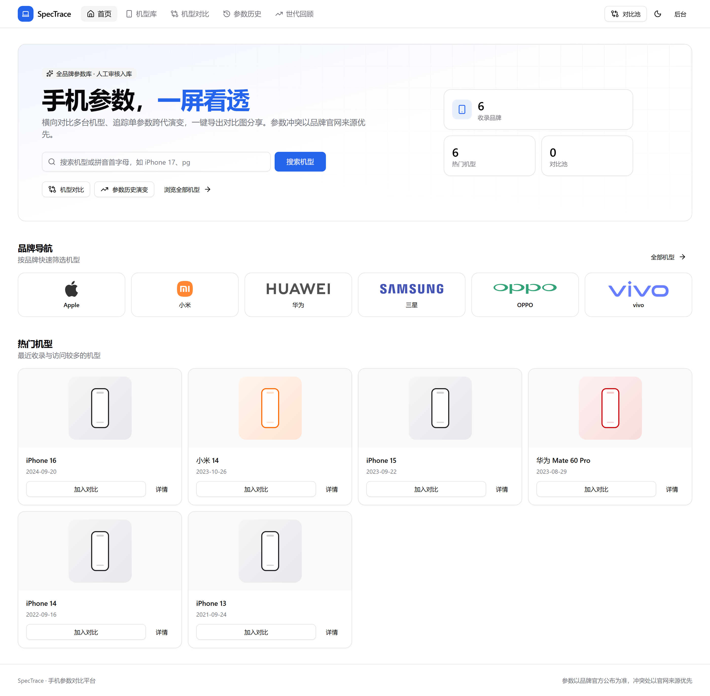
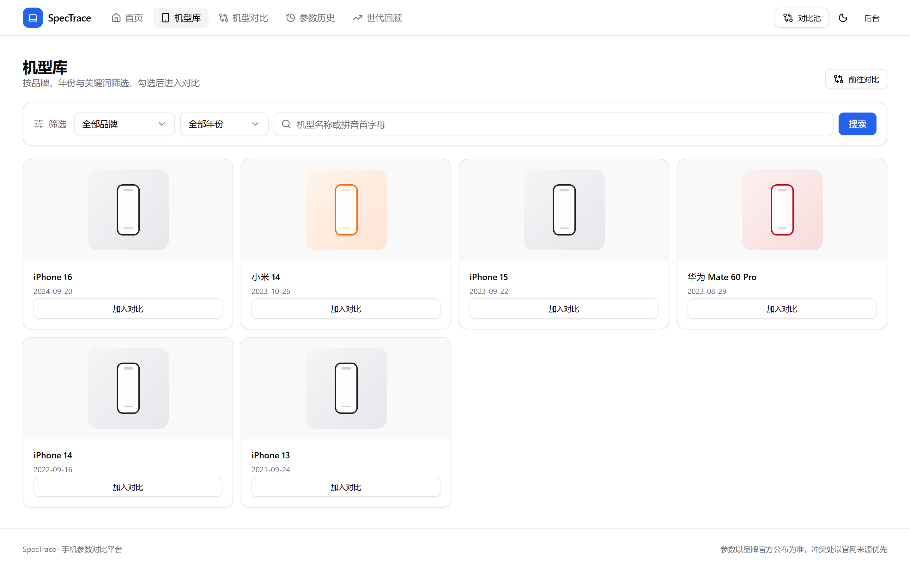
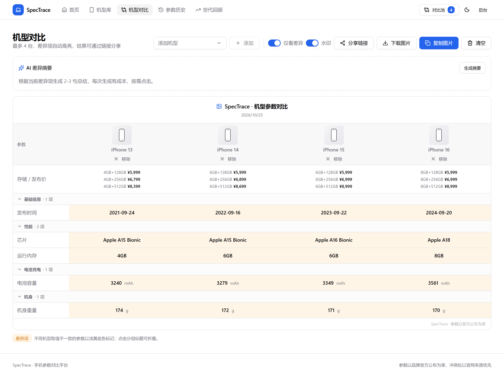
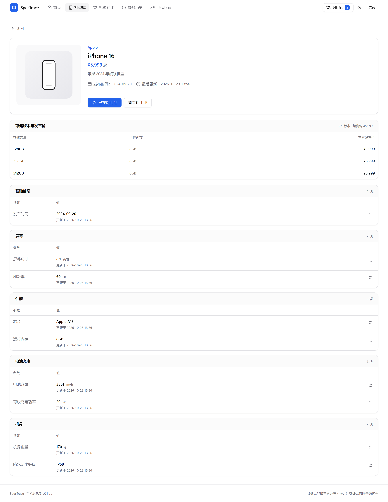
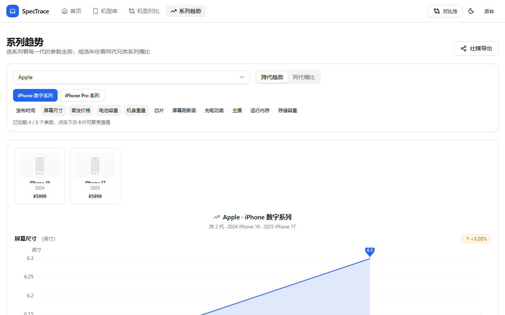
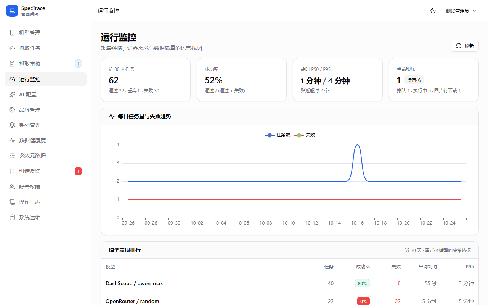
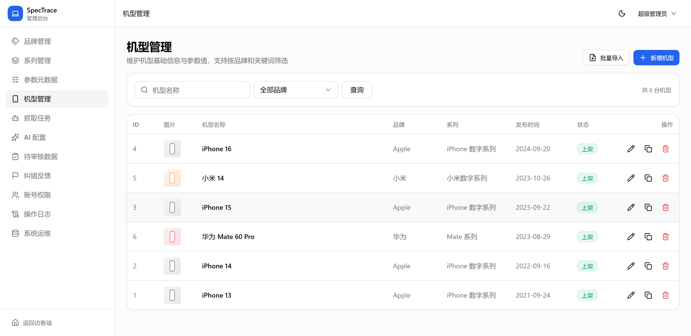
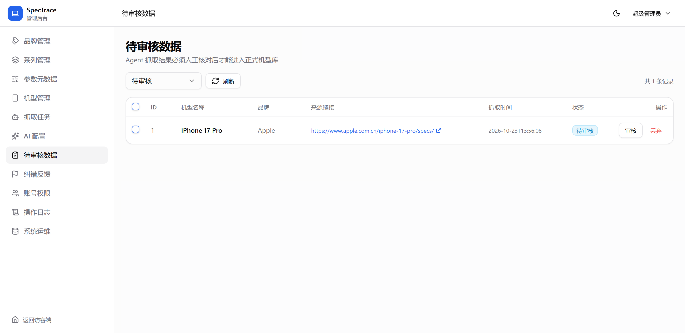

# SpecTrace · 手机参数对比平台

[](https://github.com/jingyuan9527/SpecTrace/actions/workflows/ci.yml)
[](https://github.com/jingyuan9527/SpecTrace/actions/workflows/docker-publish.yml)

面向数码爱好者的手机参数数据库：收录多品牌机型参数，支持**多机型横向对比**、**单参数跨代历史演变**、**按产品线回看世代（多参数趋势）**、**对比结果一键截图分享**；数据来源为管理员手动录入 + 内嵌 AgentScope AI Agent 自动抓取（抓取结果必须人工审核后入库）。

> 仓库地址：<https://github.com/jingyuan9527/SpecTrace>
> 容器镜像：`ghcr.io/jingyuan9527/spectrace-{backend,frontend}`，以及前后端一体化镜像 `ghcr.io/jingyuan9527/spectrace-app`

## 功能特性

**访客端**

- 机型库：品牌 / 年份筛选、拼音全拼与首字母搜索联想、「系列总览」视图（收录代数、年份范围、迷你趋势一屏看全产品线）
- 多机型横向对比（最多 4 台）：差异高亮、只看差异、AI 差异摘要、社媒模板卡导出、分享链接还原现场
- 机型详情：参数分组展示、字段级「来源 / 置信度 / 更新时间」、存储版本与发布价、同系列机型互跳
- 系列趋势：**跨代**（参数卡网格 + 聚焦主图 + AI 世代回顾）与**同代横比**（兄弟系列年度对决，一键全部加入对比）双模式
- 社媒导出：模板卡（竖版 / 横版 / 聚焦版）下载、平台风格文案（AI 生图成本高，不对访客开放）
- 参数纠错闭环：详情页一键提交、拿编号查进度、管理员侧栏未读徽标
- 暗色模式、移动端适配、PWA 可安装

**数据与采集**

- 内嵌 AgentScope 采集 Agent：搜索 → 抓取 → LLM 结构化抽取 → **人工审核入库**，与后端同进程、零额外部署
- 系列发现 → 草稿机型档案 → 批量抓详情的收录闭环；系列订阅按周期自动跟进新机
- AI 预审打标：低置信度 / 单位冲突置顶排序，批量通过护栏兜底
- 字段级溯源与参数陈旧度提示（超 180 天标记「可能过期」）、系列一键重抓
- 官方产品图采集：审核页预览确认后异步下载本地化，失败只降级绝不阻塞主流程

**管理后台**

- 机型 / 品牌 / 系列 / 参数元数据管理，支持按品牌 / 系列 / 上架状态筛选，CSV 批量导入先预览校验再落库
- 抓取任务：多供应商 AI 连接、模型连通性测试、失败可换模型重试、过程日志实时滚动；待审核任务可一键跳到抓取审核页并直接打开该条结果
- AI 绘图：绘图供应商接入（OpenAI 兼容 `/images/generations`）、提示词模板增删改与默认切换（内置通用模板可复制后改）、按系列生成社媒海报（**内部工具，不对访客开放**）、绘制历史（成功/失败均可查、可连图片一起清理）
- 运行监控：采集漏斗与成功率、按模型表现排行、**模型调用统计**（按供应商 / 模型筛选调用趋势、延迟均值与 P50/P95/P99/最大、成功率、失败原因分布，支持自定义时间范围与自动刷新）、搜索需求信号（**空结果率**直接指出该补录什么）、访客流量与对比使用率、数据质量
- 数据健康度：全库带参率、参数覆盖排行、缺参机型按真实浏览量排序一键补抓
- 系统运维：SQLite 自动备份 / 一键留档 / 恢复指引、增长数据保留策略、缓存命中率与限流 429 观测
- 告警：待审核积压、备份失败、磁盘水位 → 钉钉 webhook（同规则 24h 去重）

**站点与分发**

- SEO：详情页动态 title / OG、JSON-LD Product 结构化数据、sitemap.xml、RSS 新收录订阅流
- 安全：JWT + 登录防爆破 + 初始密码强制修改、公开接口限流 / ETag 缓存、CORS 白名单、上传文件头校验

## 访问范围

产品只有两类身份：**未登录访客**与**后台账号**（`ADMIN` / `SUPER_ADMIN`），没有 C 端注册与会员体系，因此访客端不出现「登录解锁」类引导——公开内容不做登录墙，登录只代表后台员工身份。

| 能力 | 未登录访客 | 后台账号 |
| --- | --- | --- |
| 机型库 / 详情 / 对比 / 系列趋势 / 模板卡导出 / RSS / PWA | 可见可用（只读） | 同访客 |
| AI 差异摘要 / AI 世代回顾 / 社媒文案 | 可见可用（5 次/分钟/IP，全站每日共 100 次真实生成，结果缓存 24h） | 同额度 |
| 参数纠错提交 / 凭编号查进度 | 可用（1 分钟/机型/IP，编号即凭据） | 后台处理 |
| 后台：数据维护 / 采集 / 审核 / 监控 / 日志 | 不可见不可用（401 → 登录页） | 按角色 |
| 后台：账号权限 | 不可见不可用 | 列表 ADMIN 可读，写操作仅 SUPER_ADMIN |
| 后台：系统运维 | 不可见不可用 | 仅 SUPER_ADMIN |
| **AI 生图（社媒海报）** | **不提供入口** | **仅后台「AI 绘图 → 生成海报」内部使用** |

> 草稿 / 下架机型对外按不存在处理：列表不返回、详情 404、对比直接拒绝；待审核数据、AI Key 与内部指标只在后台可见。后台入口放在页脚「管理入口」，不占访客主导航。

## 界面预览

> 截图取自内置演示数据（6 台机型 + 1 条待审核记录）。机型缩略图为按品牌主色生成的占位图，不是真实产品照片；演示机型的参数为节选，未录入的参数在页面上不显示。

| 首页：搜索、品牌导航与热门机型 | 机型库：品牌 / 年份筛选，勾选进对比 |
| :---: | :---: |
|  |  |

| 机型对比：差异高亮、水印、分享链接与复制图片 | 机型详情：存储版本发布价、参数来源与更新时间 |
| :---: | :---: |
|  |  |


| 系列趋势 · 跨代：参数趋势与聚焦主图 | 后台运行监控：采集漏斗与模型排行 |
| :---: | :---: |
|  |  |

| 后台机型管理：录入、批量导入、按系列筛选、多选归类 | 后台抓取审核：AI 抓取结果人工审核后入库 |
| :---: | :---: |
|  |  |

## 架构

```
┌──────────────────────────┐   HTTP    ┌────────────────────────────────────────┐
│  Vue3 前端（访客端/后台）│ ────────► │  SpringBoot 3.x 后端（单体应用）        │
│                          │ ◄──────── │   业务：MyBatis-Plus / JWT / RBAC       │ ──► SQLite（单文件主业务库）
└──────────────────────────┘           │   采集：内嵌 AgentScope Java 2 Agent    │ ──► 内存任务队列（可选 Redis）
                                       └────────────────────────────────────────┘
```

采集 Agent 与业务后端**同一进程、同一份镜像**：任务经队列（默认内存，可选 Redis）投递，Agent 直接调用后端 Service 完成「搜索 → 抓取 → LLM 结构化抽取 → 写待审核库」，无 HTTP 往返，也无需单独部署 Agent 服务。

**职责精简**：Agent 不直接访问数据库，只负责采集与结构化；入库、审核状态流转仍全部由 SpringBoot 掌管。
**零外部服务**：业务数据保存在 SQLite 单文件，任务队列默认使用进程内内存；只有多实例部署时才需要可选启用 Redis。

## 目录结构

```
SpecTrace/
├── backend/         SpringBoot 3.3 + MyBatis-Plus + 内嵌采集 Agent（SQLite 单文件库，src/test 为单测）
├── frontend/        Vue3 + TypeScript + TailwindCSS + shadcn-vue + ECharts + html2canvas
├── docs/screenshots/        README 界面截图（演示数据）
├── sql/             旧版 MySQL 建表脚本（仅迁移参考，当前应用不再使用）
├── .github/workflows/ci.yml               PR 校验：类型检查、构建、单测与 e2e
├── .github/workflows/docker-publish.yml   构建并推送单镜像到 GHCR
├── Dockerfile       前后端一体单镜像（构建上下文 = 仓库根目录）
├── docker-compose.yml       应用编排（默认拉取 GHCR 单镜像，SQLite 数据落宿主机挂载目录）
├── docker-compose.build.yml 源码构建覆盖文件
└── .env.example             部署环境变量样例
```

## 快速启动（本地开发）

### 1. 后端（内含采集 Agent，无需安装 MySQL / Redis）

```bash
# JWT 签名密钥为必填项（未配置会拒绝启动），先设置再启动
# Git Bash / Linux:  SPECTRACE_JWT_SECRET=<至少32位随机串> mvn spring-boot:run
# PowerShell:        $env:SPECTRACE_JWT_SECRET="<至少32位随机串>"; mvn spring-boot:run
cd backend
mvn spring-boot:run
```

- 默认使用 SQLite 文件库 `backend/data/spectrace.db`，启动时自动建表、幂等写入种子数据
- 端口 `8080`，接口文档：http://localhost:8080/swagger-ui.html
- 数据文件路径可用 `SPECTRACE_DB_PATH` 覆盖（例如 `SPECTRACE_DB_PATH=D:/data/spectrace.db`）
- 初始超级管理员：`admin / admin123`（启动时以 BCrypt 写入）；账号带「待改密」标记，首次登录强制跳转改密页——**改密强制在后端校验**：未改密的 token 只能访问认证接口；登录连续失败 5 次锁定 10 分钟
- **采集 Agent 随应用启动常驻消费任务**：先在后台「AI 配置」保存连接与模型（填好 API Key），再到「抓取任务」提交任务即可自动采集
- 关闭内嵌 Agent：启动加 `--spectrace.agent.enabled=false`（或环境变量 `SPECTRACE_AGENT_ENABLED=false`）
- 只处理一个任务（联调）：`mvn spring-boot:run -Dspring-boot.run.arguments=--once`

### 2. 前端

```bash
cd frontend
npm install
npm run dev
```

- 访问 http://localhost:5173 ，已配置 `/api`、`/uploads`、`/brands`、`/device-images` 代理到后端 8080（机型图必须走独立前缀，与 SPA 的 `/devices` 路由同名会被代理吞掉）
- 前端使用 history 路由（无 `#`）：`/` 首页、`/devices` 机型库、`/compare` 对比、`/trends` 系列趋势（跨代趋势 + 同代横比双模式；旧 `/history`、`/evolution` 链接自动重定向）
- 管理后台：`/admin/login`
- E2E（无需后端与数据库，接口由 `e2e/mock-api.ts` 拦截）：`npx playwright install chromium` 后执行 `npm run test:e2e`；失败会保留截图、trace 与视频到 `test-results/`

## 采集 Agent（内嵌）

基于 **AgentScope Java 2.0 Harness 模式**（`HarnessAgent` + `Toolkit`）：persona / 输出规约写在**工作区 `AGENTS.md`**（Harness 的「智能体定义事实来源」，运行期可直接编辑、无需改码），自定义工具 `web_search` / `fetch_page`（Jsoup 抽取正文）。

- 工作区目录由 `AGENTSCOPE_WORKSPACE` 控制（默认 `.agentscope/workspace`），首次启动把内置 persona 写入其下 `AGENTS.md`
- **persona 版本同步**：内置 `backend/src/main/resources/AGENTS.md` 升级后，启动时按内容 SHA-256 与工作区 `AGENTS.md.sha256` 比对；版本变化会把旧文件备份为 `AGENTS.md.bak-<时间戳>` 再覆盖，版本未变则保留工作区里的手工修改
- 任务获取实现由 `spectrace.agent.queue` 决定：`memory`（默认，进程内队列，无外部服务）/ `redis`（可选，`BLPOP spectrace:agent:task`，多实例部署）；后端投递与 Agent 消费共用同一实现
- **任务可靠性**：消费线程对单任务异常兜底（任务落为失败，线程不退出）；应用启动时自动恢复中断任务——RUNNING 置为失败，内存队列丢失的 QUEUED 重新入队（Redis 队列本身持久，不重复入队）；入队失败的任务直接落为失败，不会留 QUEUED 僵尸
- 每个任务执行前解析一次 AI 模型参数，后台「AI 配置」改完**下个任务即生效**，无需重启
- AI 连接（服务商 / 接口地址 / API Key）与模型在后台「AI 配置」页面维护：保存连接后可**拉取远端模型**（支持关键字筛选，全选只作用于筛选结果）、逐个模型**连通性测试**（发最小对话请求验证 Key 与模型可用性，展示延迟或错误详情）、一次导入多个模型并设默认；创建抓取任务时可指定模型，缺省用默认模型
- 页面顶部「**采集搜索源**」配置采集 Agent 的搜索引擎：`Tavily`（API Key）/ `SearXNG`（自建实例地址 + 可选 Token，需开启 JSON 输出）/ `Serper`（Google 结果）可**同时启用多个**，并在编辑弹窗内通过**拖拽或上下移调整调用优先级**（默认 Tavily → SearXNG → Serper，可一键「恢复默认排序」，只调顺序不改启用集合）；运行时按该顺序尝试第一个可用引擎，全部失败回落 DuckDuckGo（一个都不启用即系统默认链）。卡片上直接展示「生效顺序：A → B → DuckDuckGo」，保存后下个抓取任务生效。支持一键真实搜索测试（弹窗内可用未保存的表单值测试，Key 留空沿用已存值），启用 Tavily 时测试会附带返回**剩余积分用量**。卡片内「Tavily 用量」面板直接给出**本月剩余积分**（大号数字 + 进度条 + 剩余百分比），并展示计划、已用/额度与数据更新时间、手动刷新按钮；后端缓存 10 分钟、60 秒内重复刷新只回缓存，规避 Tavily `/usage` 的 10 次/10 分钟限流（`GET /api/admin/search-config/tavily-usage?refresh=`，额度按账户月度口径，缺失时回落本 Key 口径）。Tavily 与 SearXNG 返回内容摘要，是网页被反爬拒绝时模型的降级信息源。改完下个任务生效，无需重启

可调环境变量（`application.yml` 中均有同名默认值）：

| 变量 | 默认 | 说明 |
| --- | --- | --- |
| `SPECTRACE_DB_PATH` | `./data/spectrace.db` | SQLite 数据文件路径 |
| `SPECTRACE_AGENT_ENABLED` | `true` | 是否启用内嵌采集 Agent |
| `SPECTRACE_AGENT_QUEUE` | `memory` | 任务队列：`memory` / `redis` |
| `AGENTSCOPE_WORKSPACE` | `.agentscope/workspace` | Harness 工作区目录 |
| `POLL_INTERVAL_SECONDS` | `5` | 阻塞等待任务的超时（秒） |
| `TASK_TIMEOUT_SECONDS` | `420` | 单任务最长耗时（秒）；剩余时间低于「单次模型超时 + 15s」时工具停止执行并要求模型基于已有信息交卷；真超时后还会用已抓取正文做一次二次抽取，仍不行才转待审核交人工 |
| `MODEL_TIMEOUT_SECONDS` | `45` | 单次模型请求超时（秒），模型 API 挂死时快速失败；该值同时决定上面的交卷储备，调大需同步确认 `TASK_TIMEOUT_SECONDS` 留足采集时间 |
| `CRAWL_INTERVAL_SECONDS` | `2` | 每次外网请求间隔（秒），抓取风控 |
| `SEARCH_RESULT_LIMIT` | `5` | 搜索结果条数上限 |
| `SERPER_API_KEY` | 空 | Serper（Google 搜索结果）Key 的默认值；后台「AI 配置-采集搜索源」里的配置优先于环境变量 |
| `DASHSCOPE_API_KEY` / `DASHSCOPE_MODEL` | 空 / `qwen-max` | 后台未配置 AI 连接时的兜底 |
| `AGENT_ALERT_THRESHOLD` | `3` | 采集任务连续失败达到该次数写 `AGENT_CONSECUTIVE_FAILURE` ERROR 日志，0 关闭 |
| `AGENT_ALERT_WEBHOOK` | 空 | 告警 webhook（钉钉机器人文本消息格式），留空只写日志 |
| `SPECTRACE_SUBSCRIPTION_CRON` | `0 0 5 * * *` | 系列订阅抓取的每日检查时间（默认 05:00，排在备份与清理之后） |
| `SPECTRACE_PUBLIC_BASE_URL` | 空 | 站点对外域名（含协议），用于 sitemap / robots；反向代理部署必须配置，否则回退请求域名 |
| `SPECTRACE_JWT_SECRET` | 空（**必填**） | JWT 签名密钥，未配置拒绝启动；建议 `openssl rand -hex 32` 生成 |
| `SPECTRACE_CORS_ORIGINS` | 空（任意来源） | 跨域白名单（逗号分隔，如 `https://a.com,https://b.com`）；公网部署务必收敛 |
| `SPECTRACE_PUBLIC_QPM` | `120` | 公开接口单 IP 每分钟请求上限（feedback / insight 另有更严格限流，叠加生效） |
| `SPECTRACE_RETENTION_ENABLED` / `_CRON` | `true` / `0 0 4 * * *` | 增长数据定时清理开关与计划（默认每天 04:00，排在 03:30 备份之后） |
| `SPECTRACE_RETENTION_SEARCH_LOG_DAYS` | `90` | 访客搜索词聚合的保留天数 |
| `SPECTRACE_ALERT_CRON` | `0 0 * * * *` | 运行告警评估频率（每小时；启动后 1 分钟另有一次首查） |
| `SPECTRACE_ALERT_PENDING_COUNT` / `_PENDING_OLDEST_HOURS` / `_DISK_FREE_MB` | `20` / `48` / `1024` | 待审核积压条数、最老滞留小时、磁盘剩余 MB 三条告警阈值，0 关闭对应规则 |
| `SPECTRACE_RETENTION_TASK_DAYS` / `_PENDING_DAYS` / `_OPERATION_LOG_DAYS` / `_VIEW_DAILY_DAYS` | `30` / `30` / `90` / `90` | 终态抓取任务（含过程日志）、已处理待审核、操作日志、机型浏览量按天聚合的保留天数 |
| `SPECTRACE_RETENTION_AI_CALL_DAYS` | `30` | 模型调用明细（`ai_call_log`，逐次模型请求）的保留天数 |
| `SPECTRACE_UPLOAD_MAX_BYTES` | `8388608` | 单张图片硬上限（字节）；前端会先压到 500KB，超限提示裁剪 |
| `SPECTRACE_AI_INSIGHT_ENABLED` | `true` | 是否开放 AI 摘要类能力（对比差异摘要、世代回顾文案），未配置模型时前端自动隐藏入口 |
| `SPECTRACE_AI_INSIGHT_CACHE_HOURS` | `24` | 摘要缓存时长（小时），同一组机型与参数值在窗口内复用 |
| `SPECTRACE_AI_INSIGHT_DAILY_QUOTA` | `100` | AI 文本全站每日真实生成次数上限（对比摘要/世代回顾/社媒文案共享，缓存命中不计数），超限回 429 提示「今日生成次数已达上限」，0 不限制 |
| `SPECTRACE_AI_IMAGE_ENABLED` | `true` | 是否开放后台 AI 绘图（社媒海报）能力；关闭后后台生成页直接提示不可用 |
| `SPECTRACE_AI_IMAGE_QPM` | `3` | 单个管理员每分钟生成次数上限 |
| `SPECTRACE_AI_IMAGE_TIMEOUT_SECONDS` | `120` | 单次绘图请求超时（秒） |

抓取任务支持两种模式：**单机型抓取**（结果写入【待审核数据表】，管理员在后台「抓取审核」中修正并审核通过后迁移到正式机型库）与**系列发现**（输入系列关键词如 `iPhone 17`，Agent 返回该系列机型清单，在任务详情勾选后创建为草稿机型档案——前台不可见；再到「机型管理」对单个或勾选多台机型发起详情抓取（提交前可切换供应商与模型），审核通过后自动上架；机型也支持勾选批量上架 / 下架）。

## 生产部署

推荐只部署**一个镜像**（`spectrace-app`）：前端 SPA 已打进后端 Jar，站点与 API 同源，一个容器、一个进程，含内嵌采集 Agent。

### 方式一：Docker Compose（推荐）

三步部署（服务器只需装好 Docker，无需源码）：

1. `cp .env.example .env`
2. 打开 `.env`，只改三项：`HTTP_PORT`、`SPECTRACE_DATA_DIR`、`JWT_SECRET`
3. `docker compose up -d`

> `JWT_SECRET` **无默认值**：留空或不填时 `docker compose` 会直接报错退出（不会带着示例串启动）。生成方式：`openssl rand -hex 32`。

然后访问 `http://<服务器IP>:<HTTP_PORT>`，后台 `/admin/login`（默认 `admin / admin123`，首次登录会强制跳转改密页，不修改无法进入后台）。

编排文件：

| 文件 | 内容 |
| --- | --- |
| `docker-compose.yml` | 单服务 `app`：镜像 `spectrace-app`，宿主机 `${HTTP_PORT:-80}` → 容器 `8080`；SQLite 数据写入宿主机目录 `${SPECTRACE_DATA_DIR:-./data}`（挂载到容器 `/data`） |
| `docker-compose.build.yml` | 可选覆盖文件：改为从仓库根目录源码构建单镜像 |

**从源码构建**（有源码 / 需改代码）：

```bash
docker compose -f docker-compose.yml -f docker-compose.build.yml up -d --build
```

- `.env` 只需上面三项；`IMAGE_TAG`、`SPECTRACE_AGENT_ENABLED`、`SPECTRACE_AGENT_QUEUE` 均为可选覆盖（默认 `latest` / 开启采集 / 内存队列），不改即用默认
- 数据**不落 Docker 卷**：`SPECTRACE_DATA_DIR`（默认 `./data`，即 compose 执行目录下的 `data/`）挂到容器 `/data`，数据库 `spectrace.db` 与上传文件都在其中；备份直接复制该目录
- `SPECTRACE_DATA_DIR` 建议用**绝对路径**（如 `/opt/spectrace/data`），避免相对路径随执行目录漂移；目录须存在且容器内进程（默认 root）可写
- AI 连接/模型在后台「AI 配置」页面维护，无需改环境变量；站点与 Swagger 同源：`http://<服务器IP>:<HTTP_PORT>/swagger-ui.html`
- 若镜像包为私有，先登录：`echo <PAT> | docker login ghcr.io -u <用户名> --password-stdin`

**日常运维**

- 升级：`docker compose pull && docker compose up -d`
- 日志：`docker compose logs -f app`
- 停止：`docker compose down`（数据在宿主机目录，`-v` 不会删除数据；删数据＝删除 `SPECTRACE_DATA_DIR` 目录）
- 健康检查：`GET /actuator/health`（含 liveness / readiness 探针组，可直接用于容器探针）；`/actuator/metrics` 需要登录后访问
- 自动备份：默认每天 03:30 用 `VACUUM INTO` 生成一致性快照到 `${SPECTRACE_BACKUP_DIR}`（compose 下为 `/data/backups`），只保留最近 `SPECTRACE_BACKUP_KEEP`（默认 7）份；可用 `SPECTRACE_BACKUP_CRON` 改时间，`SPECTRACE_BACKUP_ENABLED=false` 关闭
- 手动备份：后台「系统运维」页可立即生成快照并查看现有备份（仅超级管理员），对应接口 `GET/POST /api/admin/maintenance/backups`
- 备份恢复：停容器后把 `spectrace-<时间戳>.db` 复制为 `SPECTRACE_DB_PATH` 指向的文件（默认 `/data/spectrace.db`）再启动即可，备份文件本身就是完整 SQLite 库

> 注意：表结构由后端启动时自动创建，脚本幂等；升级不会清空已有数据。需要回滚或迁移时先备份宿主机数据目录 `SPECTRACE_DATA_DIR` 中的 `spectrace.db`。

### 方式二：直接 docker build / run（不用 Compose）

```bash
docker build -t ghcr.io/jingyuan9527/spectrace-app:latest .

docker run -d --name spectrace-app -p 80:8080 \
  -e SPECTRACE_JWT_SECRET=*** \
  -e SPECTRACE_UPLOAD_DIR=/data/uploads \
  -v /opt/spectrace/data:/data \
  ghcr.io/jingyuan9527/spectrace-app:latest
```

> 构建上下文必须是**仓库根目录**（需同时读取 `frontend/` 与 `backend/`），根目录 `.dockerignore` 已排除 `node_modules`、`target` 等无关文件。

### 方式三：传统部署（单个 Jar）

1. 构建并启动：`cd backend && mvn -B package -DskipTests`，再 `java -jar target/spectrace-backend-1.0.0.jar`
   - 该 Jar **已内含采集 Agent**，无需单独部署
   - 数据目录（含 `spectrace.db` 与上传文件）建议用环境变量指定：`SPECTRACE_DB_PATH=/opt/spectrace/data/spectrace.db`（默认 `./data/spectrace.db`）
   - 必改密钥：`SPECTRACE_JWT_SECRET`；上传目录：`SPECTRACE_UPLOAD_DIR=/opt/spectrace/data/uploads`
   - 任务队列默认 `memory`；多实例部署可设 `SPECTRACE_AGENT_QUEUE=redis` 并配置 Redis
   - 如需关闭采集：`SPECTRACE_AGENT_ENABLED=false`
2. 单 Jar 只提供 API；如需自带站点，用方式一/二的单镜像（`Dockerfile` 会把 `frontend/dist` 打进 Jar），或 `cd frontend && npm run build` 后自行托管 `dist/` 并反向代理 `/api`、`/uploads`、`/brands`
   - 前端为 history 路由，自行托管时需把未匹配的页面路径（如 `/compare`、`/devices/7`）回退到 `index.html`；打进 Jar 时已由 `ResourceConfig` 处理

## CI/CD（GitHub Actions）

工作流：

- `.github/workflows/ci.yml`：PR 与主干推送跑前端 `typecheck` / `build` / e2e、后端 `mvn -B package`（含单测）；npm 与 Maven 依赖缓存，e2e 失败上传 trace / 截图 / 视频
- `.github/workflows/docker-publish.yml`：镜像构建与发布，见下

- **触发**：推送到 `main`、打 `v*` tag、手动 `workflow_dispatch`；Pull Request 仅构建校验、不推送
- **产物**：`ghcr.io/jingyuan9527/spectrace-app`（前后端一体单镜像，含采集 Agent）
- **构建**：上下文为仓库根目录，使用根目录 `Dockerfile`（先构建前端，再并入后端 Jar）
- **架构**：发布时构建 `linux/amd64` + `linux/arm64` 多架构镜像（`docker pull` 自动匹配），PR 仅校验 `linux/amd64`
- **标签**：分支名、tag、`{{version}}` / `{{major}}.{{minor}}`、`sha-<短哈希>`、默认分支的 `latest`
- **权限**：使用内置 `GITHUB_TOKEN`（`packages: write`）登录 GHCR，无需额外 Secrets
- **缓存**：Buildx `type=gha` 分层缓存，加速重复构建
- **注意**：镜像自带 SQLite 驱动，运行时不依赖外部数据库；首次推送后可在仓库 Packages 页把包的可见性设为 Public（否则部署端需先 `docker login ghcr.io`）

## 实现要点

> 上面「功能特性」是给使用者的说明；本节是给研究实现的同学的深水区——动态参数模型、采集可靠性、缓存与安全护栏等设计取舍都在这里。

- **动态参数**：`brand / param_group / param_def / device / device_param_value` 分离，新增参数只需向 `param_def` 插入记录，无需 DDL 改表；新增品牌/参数不影响业务代码。
- **存储版本与发布价**：`device_variant` 按机型存多条版本记录（存储容量 / 运行内存 / 发布价 / 币种），详情与对比接口一并返回并计算起售价；采集 Agent 在输出 JSON 中额外给出 `variants` 数组，待审核页可修正，审核通过后写入正式表。查不到价格的版本只保留容量、不猜测数值。
- **参数全量覆盖**：保存机型参数时以提交的 `paramKey -> value` 为准，未提交或值为空白的参数键会被删除；仅当 `params` 为 null（未提供）时才不改动既有参数。删除的品牌/用户等采用逻辑删除，唯一键（`param_key` / `username`）通过 SQLite 部分唯一索引 `WHERE deleted = 0` 保证软删后仍可重建同名记录。
- **品牌 Logo 内置静态资源**：品牌 logo 是随 Jar / 镜像发布的 `backend/src/main/resources/static/brands/*.png`（1280px 高清 PNG，取自 Wikimedia Commons 的公有领域 / PD-textlogo 矢量文件），接口返回 `/brands/<名称>.png`；单镜像部署前后端同源无需代理，本地 `vite` 开发已代理 `/brands`，替换 logo 直接覆盖文件或改 `brand.logo` 即可。
- **对比差异高亮**：后端 `compare` 接口返回每行参数的 `same` 标记，前端据此高亮差异、置灰相同项。
- **对比池**：最多 4 台，选择结果持久化到 localStorage 并同步到 URL（`?ids=`）便于分享；工具栏提供「清空」（二次确认），只清除本地选择与当前对比结果。
- **截图分享**：`html2canvas` 截取对比/图表区域，支持下载 PNG、复制到剪贴板，水印可开关；截图时自动隐藏交互控件保证画面干净。
- **内嵌采集 Agent**：`TaskQueue` 抽象（内存 / Redis 按配置切换），Agent 与后端同进程直接调用 Service，抓取结果先进待审核库，人工审核通过才迁移；无需单独服务与内部回调令牌。
- **抓取过程日志**：采集每一步（开始、搜索关键词与命中数、抓取网页与正文字数、抽取结果与被丢弃的未知参数、写回待审核）追加到 `agent_task_log`，后台任务详情按 3 秒增量轮询（`afterId`）展示，任务结束自动停止轮询。日志写入失败只降级为应用日志，不影响抓取主流程。
- **失败重试可换模型**：失败任务重试时可在弹窗中更换供应商连接与模型（默认沿用原模型）；超时类失败会在错误信息中标注「期间是否有工具调用」，区分模型 API 无响应与工具链路卡住。同品牌同名机型已有审核通过的抓取记录时，失败行标记「已入库」且不再提供重试，避免重复抓取已入库机型（判定依据是 `agent_pending_data` 的 APPROVED 记录，手工新增 / 导入的机型不受影响）。
- **时间预算与反爬韧性**：任务内工具带剩余预算闸门（临近超时停止执行、要求模型基于已获取信息输出结果）、搜索/抓取去重缓存（同 URL / 同关键词不重复请求）、401/403 域名熔断（拒绝抓取的站点本任务内不再尝试，失败域名写入任务摘要供审核参考），`fetch_page` 请求带完整浏览器特征头（UA / Referer / Accept-Language）降低误杀率。
- **待审核去重**：回调写入待审核库时，同一任务重复回调复用原记录（幂等）；同品牌同机型已有待审核记录时用最新抓取覆盖并关闭旧任务，避免同一机型抓两次在审核队列里堆成两条雷同数据。
- **系列机型发现**：抓取任务按类型分流（`agent_task.task_type`）；「系列发现」用独立提示词只产出机型清单，勾选后批量创建草稿机型（`status=0`），机型管理页支持行级与批量「抓取详情」（提交前可选供应商与模型）、勾选批量上架 / 下架，审核通过复用既有覆盖逻辑自动上架；清单项自动标注库中已存在的同名机型，创建幂等。
- **AI 连接与模型集中管理**：后台「AI 配置」维护多个供应商连接（服务商 / 接口地址 / API Key），支持**拉取远端模型列表**批量导入、导入多个模型并设置默认；创建抓取任务时可指定具体模型，缺省用默认模型。Agent 每任务解析并构建大模型（DashScope 原生或 OpenAI 兼容端点，兼容 DeepSeek / Kimi / vLLM / Ollama）。
- **LLM 抽取约束**：Agent 系统提示强制按 `param_def` 定义的 `param_key` 输出 JSON，并对未知键做丢弃清洗。
- **字段级溯源**：`device_param_value` 记录 `source_url` / `confidence` / `updated_at`，审核通过时把抓取来源写入对应参数值；人工修正会清空来源并把更新时间刷新。详情页逐行展示来源、置信度与更新时间，页头展示机型最后更新时间；参数更新时间超过 180 天的行与页头显示「可能过期」提示（T87，OTA / 调价都会让旧值失真）。同一参数被访客反馈纠错的条数会聚合为「N 人待核实」灰标（T97）：访客提交后即时可见，管理员处理完自动消失，不做无来源的猜测提示。
- **置信度链路**：Agent 输出可选 `paramConfidence`（参数级 0~1），缺省时回落到整次抓取的 `confidence`（high/medium/low 映射为 0.9/0.7/0.4）；审核页对低于 60% 的参数标注「建议核实」，管理员改过的参数按人工确认处理、清掉置信度。
- **参数值单位解析**：`6.1英寸`、`3600mAh`、`1TB` 这类取值会拆出数值与单位，同量纲（长度/存储/电池/重量/频率/功率）自动换算到参数定义的单位后再对比；量纲不一致或无单位定义时，历史图表提示冲突并按原值展示，导入预览与审核页也会给出警告。
- **产品图采集本地化**（T90）：Agent 输出可选 `imageUrl`（官方产品图直链）；审核页预览确认后通过——**与主流程完全解耦**：审核事务内零网络请求，只落待下载 URL，由独立单线程在提交后异步下载（文件头校验 / 大小上限 / 15s 超时），失败只清标记保留占位图并写日志，不重试不阻塞；已有真实上传图不覆盖，启动时自动恢复中断的下载队列，兜底是手动上传。
- **AI 预审打标与风险排序**：待审核列表按风险置顶——建议核实（低置信度 <0.6 或单位冲突）→ 值有变更（与库中现有值有差异）→ 普通 → 可信（全部参数置信度 ≥0.9 且无任何冲突），同级按创建时间倒序；仅基于抓取结果本地数据评估，不发外部请求，不改变「必须人工审核」的定位。审核弹窗显示「建议核实 N 项 / 建议直接通过 M 项」分组徽标；批量通过勾选中含可疑项时先弹护栏确认。
- **审核 diff 与覆盖更新**：待审核详情会返回同品牌同名机型的现有参数，审核页标出「旧值 → 新值」并折叠未变化项；审核通过时若库中已有同名机型则覆盖更新参数，避免重复抓取产生重复机型。支持多选批量通过 / 批量丢弃。审核弹窗操作栏以 sticky 悬浮在弹框底部、滚动时始终可见，左侧显示「将新增入库 / N 项参数有变化 + 建议核实数」；移动端主操作与「丢弃」满宽堆叠，取消交给右上角关闭。
- **纠错反馈**：访客在详情页参数行点旗标即可提交建议值与说明（同来源同机型 1 分钟限流），提交成功返回**随机公开码**（8 位 base62，防自增 id 被枚举；历史纯数字编号仍可查询），可凭编号在纠错弹窗查询处理进度（`GET /api/public/feedback/{code}`，只返回编号、状态与时间）；后台侧栏「纠错反馈」展示待处理数徽标（`GET /api/admin/badges`），列表核实后标记已处理 / 已忽略。
- **批量导入**：后台机型页支持 CSV 导入，模板列与 `param_def` 的 `param_key` 同步生成；上传后先预览逐行校验（品牌是否存在、日期格式、重复机型），确认后逐行落库，单次上限 500 行。可选 `series` 列（兼容「系列」「产品线」）按品牌内名称匹配、不存在则自动建系列，留空视为未归类，预览会提示「将新建系列 xxx」。
- **产品线（系列）与系列趋势**：`device_series` 按产品线人工维护，`device.series_id` 可空（未归类机型照常展示，只是不进趋势）；后台「系列管理」支持品牌筛选、拖拽排序、编辑、合并（机型迁移后删源系列）与删除（有机型在册时拒绝），提供「未归类机型」逐行归类、行级「系列机型清单」（`GET /admin/series/{id}/devices`：搜索、逐行或批量移动归属，可移出为未归类，移动即时生效并记录原系列 → 新系列日志）与「订阅抓取」（按周期自动创建系列发现任务，发布季不掉队，见 T88）；支持 **AI 推荐系列**（按品牌生成产品线候选如数字系列/se/Pro 系列，同名已存在自动标注，勾选后批量创建）。机型管理页支持按系列筛选（含「未归类」）与勾选多台一键加入同系列。访客端 `/trends` 以系列为中心、双模式呈现：**跨代趋势**（品牌 + 系列 chips → 世代缩略图条 + 参数卡网格（每参数一条内联 SVG 迷你趋势 + 涨跌徽标，默认屏幕尺寸 / 电池容量 / 重量 / 起售价，chips 增换上限 8）+ 点击卡片聚焦为 ECharts 大图（极值标注）；文本参数以值序列呈现）；图片导出统一走社媒导出弹窗的固定画布模板卡——竖版 3:4（多参数小卡）/ 横版 16:9 / **聚焦版 3:4**（1080×1440 单参数海报，自动带入当前聚焦参数），产物固定亮色不跟随站点主题，替代原网页整块截图；**同代横比**（品牌 + 年份 chips → `GET /api/public/series/generation?brandId=&year=&paramDefIds=` 返回各兄弟系列当年代表机型（同年多款取发布最晚，无新机系列占位）与参数单点值，并排卡片带中性「最高/最低」标注，可一键全部加入对比页）。`launch_price` 统一取 `device_variant` 最低价，涨跌幅在前端按首末数值计算，筛选条件同步到 URL 便于分享；`/history`、`/evolution` 旧链接自动重定向到 `/trends`。公开侧所有系列口径只统计已上架机型（草稿不进趋势、不计代数）。
- **机型库与系列趋势的连接**：机型详情接口附带所属系列与同系列机型序列；详情页展示「所属系列」卡——同系列机型横向条（当前机高亮、可点互跳），系列下已收录 ≥2 代时显示「系列趋势」入口（跳 `/trends?mode=cross&seriesId=`），仅 1 代时显示「已收录 N 代 · 数据持续收录中」。数值型参数行带「查看参数走势」入口，直达 `/trends?mode=cross&seriesId=&paramDefId=` 并聚焦该参数（文本参数、未归类机型不显示）。稀疏数据防御：跨代模式可见世代不足 2 时不画单点图，改为收录进度文案，管理员登录可见「去后台补抓」按钮。后台「系列管理」每行展示完善度「带参 N/M」（含草稿），行级「补抓缺参机型」对无参数值的机型批量发起抓取（提交前可选模型），行级「重抓全系列」圈定无参数或参数超过 180 天未更新的机型（T87），「系列发现」直达抓取任务页并预填品牌。
- **机型库系列总览**：机型库页「机型列表 / 系列总览」双视图（URL `?view=series` 可分享），品牌筛选联动。系列卡片按产品线汇总：收录代数与年份范围、最新一代代表机型、屏幕尺寸与起售价两条 SVG 迷你趋势（悬停可看各年份数值），点击直达系列趋势；未归类机型在总览底部汇总展示，点击切回列表视图。趋势刻意用内联 SVG 而非图表库，避免首屏页面引入重依赖。
- **图片上传**：前端 canvas 压缩到最长边 1600px 并转 WebP，超过 500KB 时逐级降质 / 降尺寸重压（最多 3×2 次），仍超限则提示裁剪而非静默失败；后端按文件头校验真实类型（JPG/PNG/WebP/GIF）并限制大小（可配置），返回访问地址与像素尺寸。
- **AI 对比差异摘要**：对比页按需生成（不自动调用），只把「有实际取值且不同」的参数行交给默认模型，最多 30 行；输出解析为 `summary + points` 并做长度裁剪。同一组机型按机型归档后的参数值指纹缓存（默认 24 小时，换机型顺序也命中），参数变更自然失效；同来源每分钟最多 5 次生成（命中缓存也计入，超限返回 HTTP 429）。未配置可用模型时接口返回 `available=false`，前端整块入口隐藏；调用失败降级为 `failed=true` 且 HTTP 200，不阻塞对比表。开关与缓存时长见 `SPECTRACE_AI_INSIGHT_ENABLED` / `SPECTRACE_AI_INSIGHT_CACHE_HOURS`。
- **SEO**：history 路由 + 详情页动态 title/description/OG 与 **JSON-LD Product 结构化数据**（品牌/型号/起售价/参数摘要，T89）；`/sitemap.xml` 输出首页、机型库、系列趋势与全部在售机型（带 `lastmod`），`/rss.xml` 输出近 30 天新收录机型（T89），`/robots.txt` 屏蔽后台、接口与上传目录；对外域名取 `SPECTRACE_PUBLIC_BASE_URL`，未配置时回退请求域名。
- **PWA 与 HTTP 缓存**（T89）：`manifest.webmanifest` + 保守 `sw.js`（静态资产 cache-first、页面导航 network-first，**/api 一律不缓存**，仅生产构建注册）；公开 GET 接口带 `Cache-Control: max-age=300` 与 ETag（feedback 查询豁免，保证处理结果实时可见），二次请求命中 304。
- **AI 世代回顾**：与对比摘要共用 `AiInsightSupport` 的护栏（同来源每分钟 5 次、结果缓存默认 24 小时、失败降级、非法 JSON 退化为纯文本）；按当前所选参数与可见世代生成一段带趋势判断的回顾，缓存 key 含可见机型与取值，换区间或改参数自然失效。只允许引用给定数值支撑的「升级明显 / 提升有限 / 略有退步」，不写购买建议。
- **AI 绘图海报**：后台独立维护**绘图供应商**（OpenAI 兼容 `/images/generations`，默认供应商全局唯一，接口地址可直接粘贴完整端点）与**提示词模板**（`{{brand}}` / `{{series}}` / `{{count}}` / `{{devices}}` / `{{yearRange}}` / `{{paramLines}}` / `{{title}}` 变量，服务端按系列与所选机型/参数渲染，未定义变量清空并记日志）。后台生成页只提交 `seriesId / deviceIds / paramDefIds / promptId / title`，提示词正文与数据全部由服务端取库生成——接口不接收任意 prompt，避免把额度当成通用出图通道；每次生成按管理员账号限流（默认 3 次/分钟），成功与失败都写 `ai_image_job`（含渲染后的提示词快照），成品图落 `uploads` 并在历史里可单条/批量删除（同时删文件）。供应商或模板缺失时 `/api/admin/ai-image/status` 返回不可用，生成页直接提示缺口。**该能力仅后台内部使用，访客端与公开接口均不提供**（生图成本高），社媒导出弹窗只保留模板卡与文案。成品图以 UUID 文件名落在 `/uploads`，作为能力 URL 公开访问（后台直链预览需要，与机型图同目录，不提供列表接口；链接外泄即可访问，属于已知取舍）。不发送 `response_format`，兼容同时返回 `b64_json` 与 `url` 的各类端点。
- **后台会话校验**：进入后台路由前调用 `/api/auth/me` 确认 token 仍有效（每次整页加载校验一次，SPA 内跳转不重复请求），失效即清本地凭证回到登录页；该校验失败时静默处理，不弹全局错误。登录态统一由 `stores/auth.ts` 维护（`token` / `user` / `isLoggedIn` / `isSuperAdmin` + `setSession` / `updateUser` / `clear`），路由、拦截器与页面不再直接读写 `spectrace-token` / `spectrace-user`。
- **账号安全**：`admin_user.must_change_password` 标记「初始密码」与「被管理员重置的密码」，登录响应与 `/auth/me` 都返回该标记，路由守卫据此把用户锁在改密页；自助改密 `PUT /api/auth/password` 必须校验原密码（JWT 只证明持有 token，不能证明是本人），改完清除标记。老库升级由 `SqliteSchemaMigration` 补列，并只对仍能匹配初始口令的账号打标记，已改密的账号不受打扰。启动日志不再打印明文口令。
- **后端会话防线**：JWT 密钥必须经 `SPECTRACE_JWT_SECRET` 注入（未配置拒绝启动）；过滤器每请求回查 `admin_user`——禁用 / 删除的账号 token 立即失效、角色与「待改密」标记以库内最新为准（未改密的 token 只放行 `/api/auth/**`）；登录同账号连续失败 5 次锁定 10 分钟并写入操作日志，可追溯爆破。
- **公开接口护栏**：`PublicRateLimitFilter` 对 `/api/public/**` 做单 IP 每分钟基础限流（`SPECTRACE_PUBLIC_QPM`，默认 120，feedback / insight 各自更严格的限流叠加生效）；`/devices` 分页 size 收敛上限 100，防止匿名一次拉全库。公开读取统一只出 `status=1` 的机型——列表、详情、对比、联想、热门、趋势、sitemap 同一口径，草稿与下架对外 404 或按不存在处理。
- **公开读缓存**：品牌、参数元信息、系列列表、机型详情走 Caffeine 进程内缓存（TTL 5 分钟兜底 + 管理端写路径 `@CacheEvict` 主动失效），机型发布年份改为 SQL 聚合，SQLite 读压力与机型库规模解耦。
- **模型调用统计**（`ai_call_log`）：采集 Agent 每轮模型请求（`RecordingChatModel` 装饰器，含流式取消）、AI 摘要单轮对话、AI 绘图请求逐次落库——按调用发生时的供应商 / 模型名称快照，连接改名或删除不影响历史口径；延迟从订阅 / 发请求开始计时，覆盖传输异常、HTTP 状态（401/403/429/4xx/5xx）、空返回与返回格式异常，业务层「模型未输出合法 JSON」回写最近一次调用而不是新增一条，保证成功率分母是真实调用次数。后台「运行监控 → 模型调用」按供应商 / 模型与时间范围聚合出趋势分桶（≤3h 按分钟、≤72h 按小时、更长按天）、均值与 P50/P95/P99/最大延迟、成功率和失败原因分布，支持自定义起止时间与 10s/30s/1m/5m 自动刷新（标签页不可见时暂停轮询）。明细默认保留 30 天，由 `SPECTRACE_RETENTION_AI_CALL_DAYS` 调整。
- **数据保留策略**：终态抓取任务（含过程日志）、已处理待审核、操作日志、机型浏览量按天聚合、模型调用明细按保留天数定时清理（默认每天 04:00，排在 03:30 备份之后），防止 SQLite 无界膨胀拖慢查询与备份；「系统运维」页展示各表行数、保留配置并支持手动清理（仅超级管理员）。
- **数据健康度看板**：`GET /api/admin/data-health` 汇总全库带参率（含草稿口径）、各启用参数的覆盖机型数排行（升序，覆盖最少的排最前）、缺参机型排行（缺参 = 有值参数数 < 启用参数数；按近 30 天 PV 倒序、无 PV 按发布时间，品牌/系列可筛）与近 30 天审核通过数、待处理反馈数；后台「数据健康度」页对缺参机型支持行级与批量补抓（复用选模型弹窗）。
- **运行监控与告警**（T99–T107）：后台「运行监控」页——采集漏斗与成功率、耗时 P50/P95、按模型成功率/耗时排行（失败多者置顶）、搜索需求信号（TOP 词与**空结果率**，`search_log` 只记词+次数+空结果次数，不记 IP 与访客标识，保留 90 天）、访客流量（日 PV、周环比、对比发起次数、TOP 机型，对比计数存 `metric_daily`）、数据质量（陈旧机型数、反馈滞留时效、被报错最多参数）；「系统运维」页新增运行时指标——Caffeine 各缓存命中率（`recordStats`）、限流 429 按归一化路径计数、SQLite 主库大小、数据盘剩余、JVM 堆/线程、备份耗时与产品图待下载数（均进程内快照，重启清零）。侧栏徽标扩展：抓取审核挂待审核条数（悬停显示最老滞留小时）。告警复用 `AGENT_ALERT_WEBHOOK`：待审核积压超限（条数或滞留时长）、备份失败、磁盘水位三条规则，同规则 24 小时至多一次，阈值 `SPECTRACE_ALERT_PENDING_COUNT` / `_PENDING_OLDEST_HOURS` / `_DISK_FREE_MB`（0 关闭），评估频率 `SPECTRACE_ALERT_CRON`（默认每小时，启动后另做一次首查）。
- **访客行为统计与热门口径**：机型详情访问与对比发起按天聚合写入 `device_view_daily`（SQLite 原子 upsert 累加；写入与查询都是尽力而为，失败只记日志并回落，绝不阻塞访客主流程）；`/devices/hot` 改为**近 30 天 PV 倒序**，窗口内无统计数据（新库）回落发布时间倒序、不足 limit 用最新机型补齐；机型管理列表附「30天PV」列，为数据健康度的补录优先级提供依据。

## 接口文档

- 后端在线文档（Swagger UI）：http://localhost:8080/swagger-ui.html

## 开发规约

- 后端：Java 21 / Spring Boot 3.3 / MyBatis-Plus / AgentScope Java 2.0（Harness，内嵌），统一响应体 `R<T>`，全局异常处理 `GlobalExceptionHandler`；`mvn test` 跑单测（参数值解析、CSV 导入预览、世代回顾聚合、AI 摘要解析与限流、模型调用失败分类与统计聚合）
- 前端：`npm run build` 验证构建；`npm run typecheck` 做类型检查；`npm run test:e2e` 跑 Playwright 主链路（访客对比分享、后台审核入库、键盘登录与弹窗、键盘完成新增品牌/机型/提交抓取/审核、后台系列增改并删与拖拽排序、系列趋势跨代聚焦/参数上限/同代横比/社媒导出/移动端、后台账号与参数维护、纠错反馈处理（含编号回执查询闭环与未读徽标）、数据健康度看板与缺参补抓、运行监控页与系统运维运行时指标、系列订阅配置与重抓、采集图预览、初始密码强制改密）
- 列表页复用：后台分页列表统一走 `src/composables/usePagedList`（分页 / 筛选 / 加载态 / 竞态兜底），新增列表页不再手写 query 与双 watch；可搜索下拉需要远程联想时使用 `Combobox` 的 `remote` 模式 + `@search` 事件
- 类型契约：前后端共享类型集中在 `frontend/src/types/api.ts`（以后端 VO 字段为准），`api/index.ts` 与各视图必须引用而非另写本地 interface；e2e 的 `mock-api.ts` 同样引用该文件，且未 mock 的接口会显式 404（不再静默返回 null），后端改字段名时 `typecheck`（含 `tsconfig.e2e.json`）会同时拦住前端与 mock
- 图表与 AI 文案复用：ECharts 生命周期统一走 `src/composables/useECharts`（按 key 注册、容器重建自动重挂、resize/卸载自动处理），AI 摘要/回顾统一 `useInsight` + `InsightCard.vue`（available/failed/429 护栏语义收口一处），新页面不得再手写图表生命周期或复制文案卡片
- 大体积依赖按需加载：`html2canvas` 与 `pinyin-pro` 词典均通过动态 `import()` 引入（截图导出与首次聚焦搜索时才加载），新增重依赖时保持同样的按需方式
- 错误语义：资源确实不存在抛 `NotFoundException`（回真实 HTTP 404，如机型详情），其它未预期异常只回「错误编号」并在日志里按同一编号记堆栈——异常 message 含 SQL / 路径，不得回给客户端
- 前端容错：渲染期异常由 `AppErrorBoundary` 兜住并降级为可重试提示，路由动态 import 失败（发版后旧 chunk 失效）自动刷新一次；新增页面不需要各自写兜底，但不要吞掉 `catch` 里的错误对象（打日志）
- 抓取入口统一：机型管理 / 数据健康度 / 系列管理三处「选模型 → 批量提交抓取」共用 `ScrapeModelDialog` + `useScrapeDispatch`（模型选项走 `useAiModels` 的 60s 缓存）；新增抓取入口直接复用，不要再复制一份弹窗与提交循环
- README 配图：`SHOTS=1 npx playwright test e2e/shots.spec.ts` 用 mock 数据重新生成 `docs/screenshots/` 下截图（默认与 CI 自动跳过）
- 可访问性：键盘路径已由 e2e 覆盖——全程 Tab + Enter 可完成登录、新增品牌、新增机型、提交抓取与审核通过，弹窗打开后焦点自动进入、Esc 可关闭；真机与读屏环境的人工复核仍需发布前补一次，自动化无法替代
- 表结构变更：新增列请同时改 `db/schema.sql` 与 `SqliteSchemaMigration`（老库靠后者补列）；**新列上的索引必须放在迁移里**，`schema.sql` 在 `CREATE TABLE IF NOT EXISTS` 之后执行，老库此时还没有该列，索引语句会直接中断启动
- 种子数据：不要引用后加列（同样会中断老库启动），需要时放到 `ApplicationRunner`（参考 `SeriesInitializer`，排在迁移之后）
